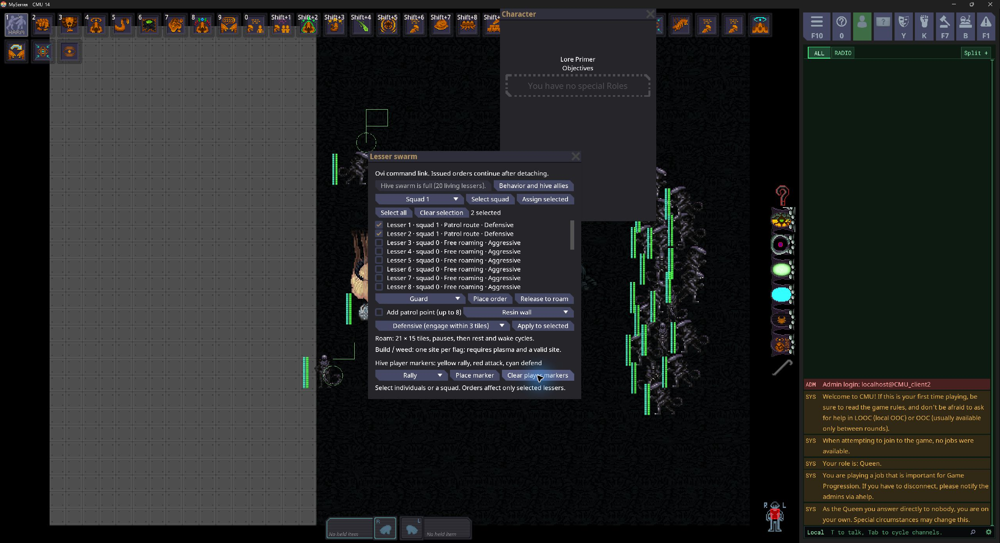

# Lesser swarm orders and ovi controls

The swarm separates a unit's persistent assignment from the Queen's temporary command session. It retains native NPC steering, melee, barricade breaching, stair traversal, xeno rest, construction, and weed planting, with bounded decision batches and stable movement destinations.

## Queen controls

Attach the ovipositor and open **Lesser swarm**. The panel shows living lessers with stable numbers, squad, assignment, aggression, and rest/build status.



- Check individual lessers, select all, or select an existing squad. **Assign selected** puts the current selection in squad 1–4, or returns it to Ungrouped. Assigning a squad does not replace its members' orders.
- Choose an order and press **Place order**, then click a world position. Escort uses the normal entity target action and accepts living, player-controlled xenos in the same hive. Queen-eye targeting uses the existing authoritative hive-vision check; body targeting uses unobstructed range.
- **Guard** moves to a stable formation and stops. **Roam area** uses a 21 × 15 tile footprint around its flag. **Patrol route** cycles between flags, pausing at each; enable **Add patrol point** when adding a waypoint. A route has at most eight points. Disable it to replace the route. Appending uses the first selected unit's route; the selected units receive the resulting route together.
- **Build resin** supports the lesser caste's resin wall, membrane, and door. **Plant weeds** requests a source node at the flag, which then spreads through the native weed system. One unit owns a shared work site at a time. Failed placements retry at intervals; completed work is not repeatedly recreated.
- **Release to roam** clears the selected units' orders and establishes a new idle roaming area at each unit's current location.
- Aggression applies only to selected lessers: Passive never acquires enemies; Defensive engages enemies within three tiles; Aggressive can pursue shared sightings within the order's twelve-tile leash. Hive-wide passive mode and alliance changes in the existing rules dialog still override combat.
- Yellow **Rally**, red **Attack**, and cyan **Defend** markers address hive players. They do not change lesser orders. **Clear player markers** removes those markers without removing order flags.

Changing a subset's patrol creates a separate route. It cannot mutate the route still used by unselected squad members. Newly summoned lessers start ungrouped and free roaming, rather than inheriting an arbitrary active squad assignment.

On ovi exit the server closes the panel, disables command actions, and discards the pending selection/placement. It rejects late UI messages and direct command actions. Existing orders, squads, and aggression remain on the units. A returning or replacement Queen can manage the living hive members again. This persistence is within the round; it is not a server-restart save system.

## Idle behavior

Unassigned lessers roam around their spawn core, or the location where they were released. They choose a destination within ±10 tiles horizontally and ±7 vertically, leaving a half-tile margin inside the displayed footprint. Candidate selection checks floor and direct obstruction, and native navigation handles the journey. Four candidates are tried per selection attempt. An unreachable destination times out instead of causing a target reroll every update.

Roaming uses 55% of normal movement speed. On arrival the lesser unregisters steering and pauses for 8–20 seconds. After 60–90 seconds without a combat interruption it uses the actual xeno rest action and animation, rests for 20–40 seconds, wakes, and resumes roaming. Explicit orders, damage, or acquired enemies wake it. Guarding, escorting, patrolling, and working do not trigger idle sleep.

## Authority, costs, and visibility

Every command checks the actor, current hive Queen, ovi attachment, allowed round mode, and selected members' hive/liveness. Player-controlled entities are excluded from lesser command selection. Flag placements check finite coordinates, the connected Z-level network, and native Queen vision.

Construction chooses from the lesser caste's native build list, then performs its regular action. Placement restrictions, weeds, plasma, construction do-afters, and interruptions remain authoritative. Weed planting retains the lesser action's restriction that another weed node must be nearby. A work flag does not grant free plasma, ignore forbidden terrain, or make a distant isolated weed node legal. A structure's normal native early-round build allowance still applies when available.

Flags have no globally visible sprite. A client overlay draws them only for a local xeno in the flag's hive, on the appropriate map. Humans and other hives do not render them. This is a display rule, not encryption of entity coordinates in the PVS.

## Scheduling and resource limits

- Each hive can summon at most **20 living swarm lessers**. A summon creates up to 15, filling only remaining slots. Dead/deleted units free their slots immediately; a full hive cannot spend the summon cooldown. Survivors retain their orders when replacements arrive.
- At most 32 member decisions and 64 hostile-candidate checks per system update across hives. Unfinished batches resume next update. Completed batches wait the existing 0.5-second think interval.
- Each observer senses at most once per second, examining at most eight candidates. Shared sightings are capped at 32 and expire after three seconds. Initial acquisition still requires line of sight.
- Stable movement destinations reuse their steering registration. Arrival removes steering; idle pauses and sleep do not keep asking for paths.
- Roaming samples are bounded. Work retries are spaced by five seconds; a failed approach relinquishes its worker after twenty seconds and backs off before trying again.
- The existing stair cache remains shared and refreshes at most once per second.
- Each hive has at most 64 order/player flags. Unreferenced order flags are collected periodically. UI roster updates run every two seconds only while a command panel is open.

These bounds limit swarm decision work. Native physics, navigation, combat, rendering, and weed propagation still have costs; they do not establish a zero-lag guarantee for a live server.

## Verification

PR verification on 2026-10-24 isolated the swarm changes from unrelated local work and built the shared, server, and client content projects, including compiled XAML. The combined suite reported **25 passed, zero failed, one skipped**. Inspection of the skipped result found an actual physical-ramp ascent assertion failure, so this is not a clean run. A focused rerun of both stair cases and per-unit aggression reported **two passed, one failed, zero skipped**, reproducing the physical-ramp failure. Existing unrelated build warnings remain.

**Open verification issue:** `CMUSwarmStairsTest.SwarmFollowsAnchorUpAndDownLinkedFloors(false)` leaves a lesser on the lower floor near the ramp exit instead of reaching the upper floor. Directional stairs pass. The cause remains unresolved; the PR remains a draft, and no assertions or timeouts were relaxed. The earlier successful suite does not supersede this reproduced failure.

Focused integration coverage exercises unit selection and route isolation; native ovi detachment and persistent movement; authorization; rest/wake transitions; aggression filtering; bounded progress through 96 units; and native construction/weed placement. A networked UI scenario opens the panel from a real client action, sends a squad assignment, and checks closure on detach.

Passing coverage includes partial/full-cap replenishment, immediate replacement of dead/deleted members, round restrictions, wall/door navigation, dense swarm separation, shared sightings, protected enemies, alliances, barricade breaching, directional-stair ascent/descent, and client collision prediction when pulling lessers. Physical ramps remain the failing case noted above.

Run the focused suite from the repository root:

```powershell
dotnet test Content.IntegrationTests/Content.IntegrationTests.csproj --configuration Debug --filter 'FullyQualifiedName~CMUQueenSwarmTest|FullyQualifiedName~CMUSwarmOrdersTest|FullyQualifiedName~CMUSwarmStairsTest|FullyQualifiedName~CMUSwarmClientCollisionTest'
```

The local verification used `.codex/scripts/run.ps1 test -Project Content.IntegrationTests -Filter '<filter above>'` to serialize builds and isolate package caches, temporary files, and test results. That wrapper is local development tooling; the direct command above targets the same tests.

Inspect the TRX output as well as the summary: this harness can report a failed assertion followed by dirty pair disposal as a skipped test. A skipped scenario is not evidence of a pass.

### Live client and server checks

A graphical client connected to a separate local server process was used to summon 15 lessers through the panel, select two individuals, assign Squad 1, place and extend a two-point patrol, apply Defensive aggression to the pair, and place a Rally marker. The other 18 members remained ungrouped and free roaming. The green patrol flags and yellow player marker rendered in game; native rest animations appeared on idle members.

Detaching through the native ovipositor action closed the panel. Server snapshots confirmed `ovi=False`, `ui=False`, both patrol assignments and flags retained, and subsequent movement/waypoint changes. Trying the menu action after detachment did not reopen it. A second, freshly built client took control of the same Queen after reattachment: the roster retained the patrol pair, selecting Squad 1 selected exactly those two, and the full-swarm summon button was disabled. The live check found roster text clipping that concealed rest status; the rebuilt roster uses short aggression names and displays those rows without clipping. Selection-dependent buttons also initialize disabled before the first roster update.

Clearing player markers removed the yellow Rally marker while retaining both green patrol flags and their assignments. The managed test server and both clients were stopped after verification. Final `git diff --check`, XAML XML parsing, and LF/UTF-8-without-BOM checks passed.

Summon attempts through the real server action, with the cooldown cleared by temporary test instrumentation, produced 15 then 20 members. Further attempts remained at 20 and did not consume cooldown. Ten independent test hives each obeyed that cap.

### Live server profile

Measured on 2026-10-24 in a Debug build on a Ryzen 5 7600 (6 cores/12 threads), with graphical clients on the same machine. The first four captures used one client; the final 20-member targeting capture used two clients with the Queen panel open, after deleting the nine extra test arenas. The default round/map remained loaded. Each synthetic hive occupied a separate 45 × 33 floor arena with a Queen and core. Captures lasted 60 seconds after spawning/warmup; no build ran during them. The 200-member case means ten hives of 20, not a bypass of the per-hive limit.

Times below are the engine's completed **Tick** profile scopes, including simulation and state sending, excluding idle sleep. At 30 ticks/second the budget is 33.33 ms. The temporary sampler contributed approximately 0.13–0.18 ms per tick and was removed from content after profiling.

| Scenario | Ticks / second | Mean tick | p95 | p99 | Maximum | Ticks over budget |
| --- | ---: | ---: | ---: | ---: | ---: | ---: |
| Baseline, no lessers | 30.00 | 3.51 ms | 4.66 ms | 5.65 ms | 9.29 ms | 0 / 1800 |
| 20 lessers, roaming/resting and issuing patrol orders | 29.98 | 5.32 ms | 7.03 ms | 8.23 ms | 23.56 ms | 0 / 1800 |
| 200 lessers across ten hives, roaming/resting | 29.96 | 17.49 ms | 22.01 ms | 24.85 ms | 247.55 ms | 4 / 1798 |
| 200 lessers, persistent hostile targets | 26.64 | 37.39 ms | 45.98 ms | 56.83 ms | 101.79 ms | 1195 / 1599 |
| 20 lessers, persistent hostile targets, two clients | 29.99 | 8.63 ms | 12.54 ms | 14.82 ms | 32.40 ms | 0 / 1800 |

The swarm system itself averaged 0.125 ms per tick with 20 members and 2.220 ms with 200. At 200, physics averaged 7.550 ms and steering 1.400 ms; atmosphere recorded a 227.906 ms maximum in the same capture. These aggregate scopes do not establish the cause of every slow tick. No completed tick samples were lost in either populated capture; the baseline excluded one incomplete frame when profiling was enabled.

The hostile-target scenario added six stationary hostile entities per hive, exercising acquisition, pursuit, crowd contact, and repeated native melee attempts. A snapshot confirmed 198 of 200 lessers had melee targets; the two Defensive patrol members retained their route. Targets had mob state and faction components but no human anatomy or damage model, so this is a synthetic targeting/contact stress test rather than full combat. At 200 members, physics averaged 21.173 ms per tick, steering 4.377 ms, swarm decisions 3.461 ms, and native NPC combat 1.695 ms. This workload exceeded the tick budget and must not be described as lag-free.

At 20 members with the same hostile targets, swarm decisions averaged 0.334 ms, physics 2.970 ms, steering 0.537 ms, and native NPC combat 0.305 ms per tick. All 1800 sampled ticks stayed within budget, including two clients and the open Queen panel.

Both capped 20-member captures stayed within the local server's tick budget. The ten-hive stress runs show why arbitrary populations are not safe. This does not simulate a production player count, latency, complex combat, or every map layout. Startup/spawn bursts and builds are outside the steady-state captures. Raw local evidence is retained in ignored `.codex/analysis/swarm-live-profiles.log`, with the temporary instrumentation source alongside it. After removing that instrumentation, the shared/server/client build passed with zero errors and existing unrelated warnings.
