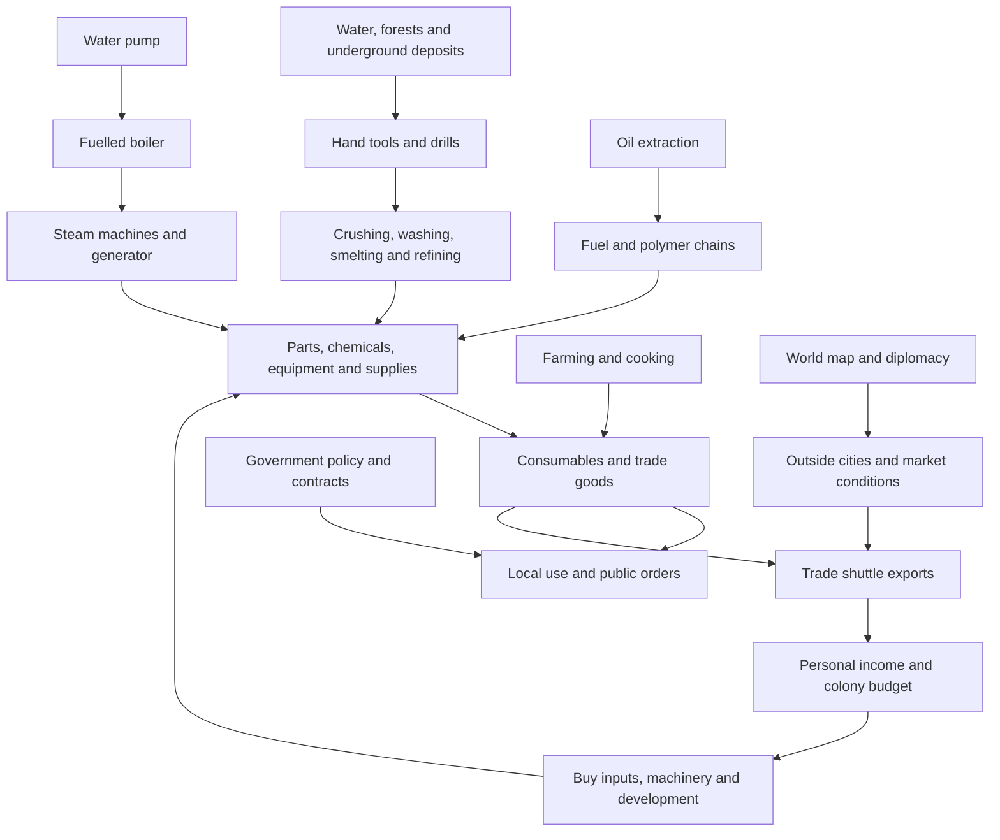

# Imported industry: gameplay and design

This describes the RussianCM systems imported into CMU, before our gameplay
rework. It distinguishes implemented mechanics from suggested player roles and
design interpretation. Exact equipment translations, prototype IDs, example
recipes and upstream source links are in
[the equipment reference](upstream-equipment-and-research.md).

## What players are building

The central loop is **survey → extract → process → manufacture → use or sell →
expand**. It starts with hand tools and fuel, grows into steam machinery, and
then branches into electrical production, chemicals, farming and automation.
The colony economy provides reasons to make goods: personal needs, public
orders, local sales and exports. Government and ambassadors can influence the
conditions under which the factory operates and sells its output.

This is a production and colony-management layer. The outside world is a
server-maintained strategic simulation of prices, cities, influence, projects
and journeys; it is not a set of fully simulated playable settlements.

## A practical progression

1. **Establish supplies.** Obtain a shovel, pickaxe, saw, hammer and the tools
   required by construction recipes. Gather wood, fibers, clay and stone.
   Trees support felling, wood processing and resin tapping. Secure a water
   location and room for processing and storage.
2. **Start extracting and working materials.** Prospect, dig into underground
   layers, bring out ores, and use furnaces, crucibles, molds and an anvil.
   Manual forging includes heating and tool strikes. Hot materials can burn
   handlers; the tools and temperature matter.
3. **Mechanize with steam.** Place a water pump on suitable water terrain,
   connect liquid delivery to a fuelled boiler, then connect its steam through
   gas pipes to machinery. Steam can operate extraction and processing or
   drive a generator. Liquid pipes and steam gas pipes are different networks.
4. **Develop electricity and specialized production.** Distribute power to
   recipe machines. Make better materials and parts; use oil, chemical and
   agricultural chains as needed. Select a circuit when recipes share inputs.
5. **Automate handling.** Arrange belts, filters, crates and machine ports.
   Output space is part of the factory: a completed operation can stop waiting
   for room. Electrical machines pause when power is lost.
6. **Connect production to demand.** Fulfil public orders, sell locally or load
   the trade shuttle. Use earnings to expand capacity or buy missing inputs.
   City prices change as goods are sold, encouraging more than one product or
   destination.

This sequence is a useful onboarding route, not a hard technology tree. The
import contains recipes and equipment, but does not enforce one universal
research progression. Cargo can shortcut early manufacture: the 1,500-credit
industry starter crate contains a steel pump, three liquid pipes, steel boiler,
industrial steam generator, drill, press, smelter and two molds. Players still
need fuel, steam connections and electrical distribution.

There are also job starting crates: the foreman receives a logistics console;
the administrator receives an administration console and three citizen
consoles; the chief engineer receives three solar panels, a step-down
transformer, an assembler, a lathe and colony APC ingredients. Open the sealed
crates with a crowbar and anchor the consoles with a wrench. These entry points
are defined in the [starting kits](../../Resources/Prototypes/CMU14/Trade/trade.yml).

## Water, steam and power

The brass pump draws 2 liquid units per second into a 50-unit tank; the steel
pump draws 4 into a 100-unit tank. It recognizes water floor entities and their
descendants. Ordinary dry ground does not provide water. Pumps currently need
no electrical or steam supply and do not deplete the source.

The custom liquid network links ports over up to 12 tiles. Each pipe carries
one reagent, and longer connections reduce flow. This creates layout and
throughput decisions even when the resource supply is unlimited. Steam uses
water vapor in the gas network instead. A machine's name does not establish
which network it consumes: the electric steam-cracking recipe uses liquid
water, and the brass condenser should not be treated as a universal steam
recovery machine.

Wood, coal and coke fuel boilers. The ordinary steam generator produces 3,000
power and the industrial version 6,000. Solar, geothermal, liquid-fuel
generation, batteries, transformers, APCs, direct cable links and cable shafts
provide other electrical options. Geothermal generation depends on nearby
lava. The industrial heavy diesel generator produces 20,000 power when its
fuel and other operating requirements are satisfied.

Source: [steam systems](../../Server/Steam), [fluid systems](../../Server/Fluids),
[energy systems](../../Server/Electric/EnergySystem.cs),
[steam prototypes](../../Resources/Prototypes/CMU14/Steam).

## Mining and processing

Mining has both breakable ore walls and surveyed floor deposits. Floor
deposits have finite reserves, typically 10,000–20,000 units and up to five
resource types. A steam drill has an eight-second cycle and produces 1–10
units per cycle, subject to what lies beneath it and its operating conditions.
Ordinary cave floor can continue yielding stone fragments after ore is gone.
The final upstream design removed drill-head and blade consumables.

Depth changes the material and tool requirement: clay at levels -1 and -2,
stone from -3 through -9, and blackstone from -10 downward. Shovels, pickaxes
and jackhammers serve different stages. Deeper generation adds rare resources
and lava. Pits, ladders, support loads, cave-ins and falling debris make access
and excavation part of the job. A pit is also a gameplay hazard; covers and
mine-detectable plates connect it to combat and detection.

Processing is not just a single conversion from ore to metal. For example:

| Route | Current example | Decision it creates |
|---|---|---|
| Grinding | Iron ore yields iron powder and stone powder | Simple mechanical processing |
| Washing | 1 iron ore + 10 water → 4 iron powder + 1 stone powder in 6 s | Better recovery in exchange for water infrastructure |
| Smelting | 3 iron powder + coke → an ingot in 10 s | Fuel supply and downstream metal output |
| Steam smelting | Mold-based batches, with slag in the ordinary model | Mold handling and waste capacity |
| Industrial upgrade | Industrial steam smelter suppresses slag | Less manual clearing and easier automation |

The electric family covers wire drawing, bending, lathing, assembly, furnaces,
alloying, chemical reactions, separation and fabrication. Many machines share
one recipe engine with different recipe categories and ports. Physical inputs
are consumed when a job starts; progress pauses without power, and output
capacity can delay completion.

Longer manual crafting recipes can invoke minigames. Very poor performance can
lose part of the material; strong performance can save inputs or add output.
These reward attention, while the later factory shifts attention toward supply
and layout.

Source: [mining](../../Resources/Prototypes/CMU14/Mining),
[underground generation](../../Server/ZLevelBuilding/ZLevelBuildingSystem.cs),
[recipe execution](../../Server/Electric/RecipeMachineSystem.cs),
[forge](../../Server/Forge).

## Oil, chemicals, food and automation

Oil deposits are finite, usually 30,000–60,000 units. The pump extracts 10 per
second. A distillation batch splits 100 oil into 20 naphtha, 40 light fraction,
30 heavy fraction and 10 gas. Further recipes turn fractions into diesel,
ethylene and polymer pellets. The branching outputs require storage and
planning; stopping one downstream consumer can leave unwanted material behind.

Water electrolysis makes hydrogen and oxygen; brine chemistry provides
chlorine, hydrogen and sodium hydroxide. These form a separate production
branch feeding more advanced materials and consumables. Farming, seed and
soil work, cooking pots and stoves provide another supply loop. Automatic
hydroponic trays consume water/fertilizer and can harvest and replant.

Belts and filters move items; machine ports transfer inputs and outputs with
nearby supported storage and transport. Belts currently run without power.
Automation therefore reduces carrying and unloading, but does not remove the
need to supply recipes, allocate output space and manage fluids.

## Colony government and local trade

Government opens from the administration console. Citizens have a separate
console for requests, orders and transactions. A surveyor's tablet marks land.
The system provides treaties and petitions, city relations, public orders,
awards, polls, loans, investments, licenses, land allocation and taxation,
contracts, auctions, tenders, subsidies and market stalls.

These are different levels of enforcement. License cards support legal roleplay:
the code explicitly expects officers to inspect most licenses and issue fines.
They do not automatically gate every mining or trading action. Building
enforcement is implemented: when enabled, the construction-menu event checks
zones and plot ownership on maps containing a government console. A valid
building permit permits construction outside a zone; it does not grant another
person's plot. This should not be described as universal protection against
every possible way of placing an object.

Design interpretation: government can turn a factory into a social activity by
commissioning goods, funding expansion, assigning land and bargaining with
outside factions. It can also create friction if too much ordinary work needs
permission. That balance remains a rework decision.

Source: [government systems](../../Server/Government),
[land enforcement](../../Server/Government/ColonyGovernmentSystem.Land.cs),
[licenses](../../Server/Government/ColonyGovernmentSystem.Licenses.cs).

## Physical shuttle trade

Heads use the foreman's console to choose an outside city and a free landing
zone, then call the colony's single trade shuttle. Colony orders spend the
public budget; personal orders spend the player's money. Ordered cargo arrives
on a real shuttle. Colonists unload purchases and hand sale goods to its
console. Loading loose cargo aboard alone is not the sale submission action.

The landing zone is occupied while the shuttle is there. Its normal landed
window is five minutes, with a three-minute away period. It will not depart
while people are aboard. Goods are appraised for departure and payment is
scheduled three minutes later: 70% goes to the colony budget and 30% to the
players who submitted them. The implementation uses a payment timer rather
than confirmation of arrival at a simulated outside city; unavailable player
shares and rounding remainders stay with the colony.

Cities have different capabilities and prices. Repeated sales reduce the price
for subsequent units of that good in that city, with recovery over time.
This connects manufacturing diversity, storage and destination selection.
The old drone trade platform is absent from the final imported design.

Source: [trade state and goods](../../Shared/Government/ColonyWorldTrade.cs),
[shuttle lifecycle](../../Server/Government/ColonyGovernmentSystem.Shuttle.cs),
[world trade](../../Server/Government/ColonyGovernmentSystem.World.cs).

## Ambassador world map

Ambassadors see a shared generated world with cities, routes, projects,
caravans, crises and hazards. Each faction has its own city influence,
headquarters trust, influence points, tasks and income. Actions include city
development, diplomacy, pacts, intelligence, counter-intelligence, covert harm,
trade and cooperation. Headquarters rewards and services connect this strategic
layer to money, delivered crates and third-party support.

The gameplay is choosing where to spend finite money/influence, deciding whom
to cooperate with, responding to changing conditions and turning success into
local benefits. Timed jobs and table-driven outcomes provide the outside-world
simulation. The design contains much more than an informational globe.

Source: [world-market state](../../Shared/WorldMarket/WorldMarketComponent.cs),
[world-market systems](../../Server/WorldMarket),
[ambassador integration](../../Server/Ambassador/AmbassadorConsoleSystem.cs).

## Suggested division of work

These are useful player activities, not newly enforced job assignments.

| Activity | Main responsibility | Dependencies on others |
|---|---|---|
| Prospector/miner | Find deposits, open safe access, extract | Tools, power/steam, supports and transport |
| Smith/machinist | Refine metals and manufacture equipment | Ore, fuel, molds and production orders |
| Utilities engineer | Water, steam, electricity and automation | Parts, space, fuel and maintenance access |
| Chemist/refiner | Oil products, reagents and advanced materials | Liquid routing, power and output storage |
| Farmer/cook | Food and agricultural goods | Land, water, fertilizer and distribution |
| Trader/foreman | Find demand, order goods, handle shuttle cargo | Product supply, landing access and money |
| Administrator | Commission work, fund development, set policy | Citizen participation, revenue and diplomacy |
| Ambassador | Build outside influence and secure benefits | Faction resources and cooperation/competition |

## Decisions for the rework

These are observations and proposals, not changes already made to gameplay.

- **Choose the intended round pace.** Compare time to first usable metal,
  powered factory and profitable shipment with a normal CMU round. No full
  round timing or multiplayer balance playtest has yet established those times.
- **Set the resource boundary.** Water and ordinary stone can be renewed
  indefinitely; ore and oil deplete. Decide whether this is intentional and
  whether pumps should consume energy.
- **Audit recipe conservation.** The thermal centrifuge can return its iron
  powder while also yielding chromium powder. Repeating that recipe creates
  secondary metal without consuming the main input. Review similar loops before
  treating every material as scarce.
- **Choose how much manual attention is fun.** Forging, minigames and repeated
  transfers compete with multiplayer duties. Automation should have a clear
  place without making early work a chore.
- **Review the economic incentive.** The 70/30 export split funds government
  more strongly than individual producers. Public orders, taxes and subsidies
  need to support that choice rather than contradict it.
- **Review shuttle failures and settlement.** Payment is scheduled before the
  return flight is confirmed to start. Check how failed departures and cleanup
  should affect sold cargo and payouts before relying on the physical journey
  as the condition for completing a sale.
- **Clarify authority and identity.** Several government records identify
  holders by character name. Review duplicate names, renaming and ownership
  transfer before relying on these records for strong access control.
- **Separate legal roleplay from mechanical gates.** Make it clear which
  licenses are evidence for officers and which actions the game actually blocks.
- **Decide the minimum viable strategic layer.** Government and the world map
  have many overlapping currencies, timers and screens. Their benefits should
  be understandable to the people producing physical goods.
- **Confirm map entry points.** This import adds systems and prototypes and
  changes existing consoles; it does not redesign each CMU map into a balanced
  industrial settlement. Place and playtest the necessary access, tools,
  utilities, work space, consoles and landing zones in a separate mapping pass.
