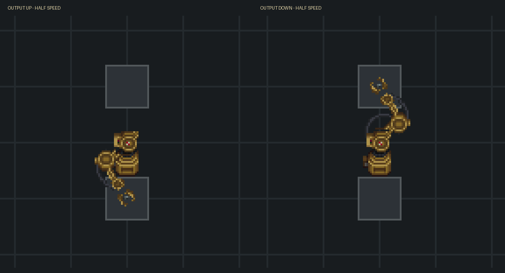

# Inserter arms

Inserters take items from the tile behind them and place them in the tile ahead.
They connect machine outputs, machine inputs, crates, storage and conveyor belts,
including machines without automatic input/output ports. Machine ingredients and
tools are never extracted as outputs.

Craft one arm with an automation kit, a drive kit and two steel, using a hammer.
There is no additional skill or research requirement beyond basic conveyor crafting.

Keep both hands free to carry the finished arm. If it is on the floor, right-click
and choose **Pick up**. While holding it, click a clear floor tile within reach to
place and anchor it. Right-click **Rotate** to turn it in quarter turns, and examine
it to see its output direction. The input is the opposite tile.

**Stop the inserter** pauses movement with the item still held. A blocked destination
also leaves the item in the claw until there is room. Use **Release the held item**
before picking up an arm that is carrying something. Rotating during a transfer
changes the next transfer's direction.

## Animation preview

This is a slowed sprite-rendered preview, not a recording of a running game.
The original upper arm and forearm pivot at their shoulder and elbow bearings.
The carried item follows the claw, and flexible cables follow their attachment points.

The factory artwork is by the cmss13 contributors, licensed under
[CC BY-SA 3.0](https://creativecommons.org/licenses/by-sa/3.0/).
It comes from [factory.dmi](https://github.com/cmss13-devs/cmss13/blob/b54dccc46f6271cd0fde9ed35897eca044bb2a88/icons/obj/structures/props/industrial/factory.dmi),
as recorded in `Content.CMU/Resources/Textures/CMU14/Structures/factory.rsi/meta.json`.
The iron ore artwork is by Alekshhh, licensed under CC BY-SA 3.0, as recorded in
`Resources/Textures/Objects/Materials/ore.rsi/meta.json`.
The preview uses the same artwork and animation transforms as the client and is
distributed under CC BY-SA 3.0.
