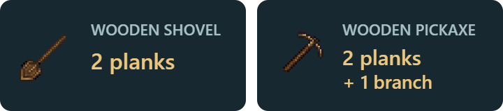
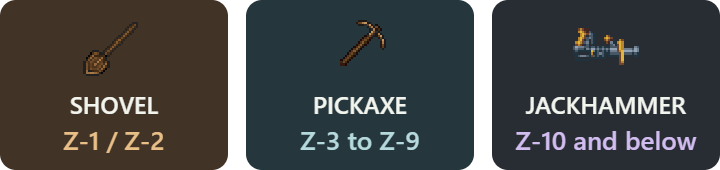
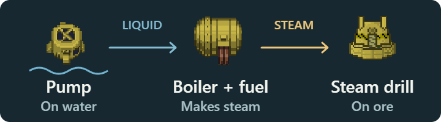

# Mining & industry — the quickstart

**Craft → dig → set up → share.** Default keys below.

## 1 · Make your tools

**Right-click yourself → Craft.** Carry the materials and required tools.

One plank makes **two branches**. Wooden digging tools last **two uses**—bring spares.

First workshop: **30 clay or stone → furnace**, **10 clay → crucible**. Add fuel; use molds and an anvil to make metal parts.

## 2 · Dig, then build a way back

**Hold tool → aim at nearby clear floor → Z → stay still.** Right-click the tool to switch up/down. Big caverns start at **Z-3**; watch for drops.

| Need | Where |
| --- | --- |
| Pit rope or ladder | Right-click pit → **Build**. One rope coil / 25 steel. |
| Portable ladder or stairs | **G → Z-Level (Experimental)**. Ladder: 10 steel + 5 plasteel. Stairs: 50 steel + 50 plasteel. |

Ladders need a wall/beam and open space above. **Build your exit first.**

## 3 · Set up your machines

**Carry portable machines with both hands → click clear floor to place.**

- **Water:** screwdriver on liquid pipe, then machine, to connect.
- **Steam:** use gas pipes between boiler and steam machines.
- **Electric machines:** supply power and recipe inputs.
- **Keep outputs clear** or production stops.

## 4 · Share what you explored

Exploration records nearby visible terrain automatically.

**G → Z-Level → cave survey map** costs **one paper**. Use **Transcribe survey**, then pass it to someone to **read**. Reopen it through the tactical-map action.

Overlapping maps keep the **newest observation**. Knowledge lasts **this round only**.

---

[More equipment](upstream-equipment-and-research.md) · [Full mechanics](gameplay-design.md) · [Sprite credits](quickstart-assets/CREDITS.md)
