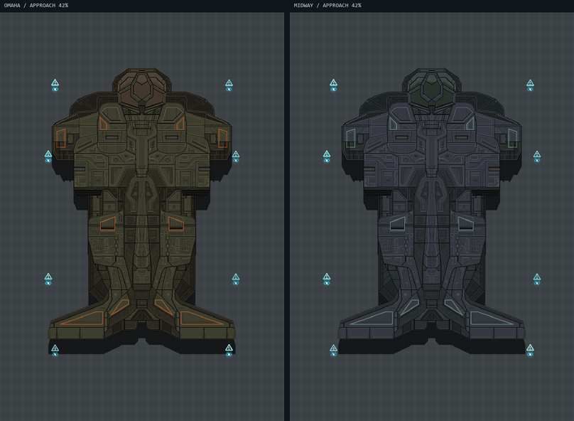

# Mohawk upstream update

Reviewed [CM-SS13 PR 12866](https://github.com/cmss13-devs/cmss13/pull/12866)
from the September import's source revision
`0d711eddc539ea7ac67cf6b5869a08fa33dc9391` through
[`4b1f9b6bcd3c456b2adca874ff89d0a7fd5ce012`](https://github.com/PoltavskaPraca/cmss13-praca/commit/4b1f9b6bcd3c456b2adca874ff89d0a7fd5ce012).
This covers 25 subsequent commits and one merge from upstream master.
The PR was still open when reviewed; this records a pinned port of its current work.

## Changes carried over

| Upstream changes | CMU result |
| --- | --- |
| Omaha cabin redesign (`4cf6db2d`, `646d62b0`) | Retain CMU's original hull, flooring, 64 seats, console positions and fixture locations in both paint schemes and deployment maps. Upgrade the nine light fixtures to double tubes and add eight ramp railings to the existing ramp edges. |
| Midway layout revisions (`ef8160d7`, `f7261691`, `3f9465f8`, `4cf6db2d`) | Updated seating, fittings, ramp edges and lighting in both paint schemes and deployment maps. |
| Double tube lights (`f7261691`) | Imported white/blue fixture art and powered-light states. |
| Fuel enhancer and cooling-system art (`f7261691`) | Equipment overrides use the new Mohawk sprites while retaining CMU's functioning mounts. |
| Ramp railings (`3f9465f8`) | Animated railings follow the ramp controls and forced departure closure through the existing networked railing system. Raised railings block pedestrians but let vehicles and powerloaders pass through. The vehicle movement probes and client/server physics contacts both honor this exception. |
| Ramp carries movable objects (`3f9465f8`) | Loose cargo follows both lowering and raising. Fixed fittings and vehicle-mounted occupants retain their existing handling. |
| Ramp audio below the cabin (`3f9465f8`) | Uses CMU's explicit cross-deck sound helper. |
| Hull-shaped arrival shadows (`775d3538`) | Imported both silhouettes, recover their faint source alpha in a shader, and tighten the shadow during descent. Compact cyan holographic beacons mark the landing zone with large gaps and real ground lighting. Each projector has a broken base ring, a floating warning symbol and a moving scan line. The current upper-deck artwork descends into place on the server's arrival timer. Approach effects are removed on landing or ship deletion. |
| Revised roof art (`a8b36f3e`, `4defcc23`) | Updated the 20 changed Omaha canopy tiles. Midway's roof and both underside images already matched the current source pixels. |

The incremental map update preserves the cabin's CMU components, faction setup,
radio, equipment, atmosphere configuration and map-specific entity overrides.
Omaha retains CMU's original 64-seat arrangement; Midway uses the updated
29-seat arrangement. Both counts include the cockpit seats. The revised roof
art, equipment art, ramp behavior and landing presentation also
apply to Omaha's original cabin layout.

## Existing CMU equivalents retained

- Landing-gear vent entry/exit from `4cf6db2d` and its null-safety fix already have
  a CMU implementation in `CMUXenoGearHatchSystem`.
- The M90 attachment/deployer fixes (`d8774aba`, `f7261691`) correspond to CMU's
  existing physical attachment points, installed-equipment visuals and dedicated
  gunnery controls.
- Powerloader stair travel (`924dbe74`, `cbf0c0b9`) is handled by CMU's vehicle
  ramp and Z-level traversal systems.
- BYOND roof planes, faux-turf culling, camera overlays and cleanup
  (`1fac9105` through `09d65a2c`, `4defcc23`, `ed617bb9`, `2692bd72`, `dfc41265`)
  are represented by CMU's real upper grid, Z-level visibility and entity lifecycle.
  The port retains CMU's later fix for retiring deck broadphases safely.
- CMU's existing crash blast, fire placement and ship-wide hull-breach rules
  remain in use. Hijacks retain the cabin wreck and retire the secondary decks;
  the upstream walkable roof above a crash site is excluded from this port.
- The overwatch type/icon cleanup (`82610ba3`) uses CMU's existing functional
  overwatch console. BYOND variable renames and TGM serialization changes do not
  require a second gameplay implementation.
- The merge from upstream master and unrelated atom-initialization machinery
  were not transplanted into RobustToolbox.

Imported artwork retains CC-BY-SA-3.0 metadata and credits to the CM-SS13
contributors. New or changed art records the reviewed source revision.

## Landing preview



Renderer preview at 42% of the approach. Engine lighting and occlusion are not
simulated. The temporary descent visual is separate from a walkable crash roof.
The preview incorporates CM-SS13 artwork by the contributors credited above and
is distributed under CC-BY-SA-3.0.

## Verification

Verified on 2026-10-27: shared/client/server builds passed; all 42 focused
integration cases passed, with zero failures or skips. All 16 map files passed
structural checks, Omaha's original entity data was verified, asset metadata
and changed YAML/JSON parsed successfully, and `git diff --check` passed.

Focused integration checks cover occupied seats and wall clearance, ramp
passengers and loose cargo, railing replication, vehicle passage, installed
equipment, flight transitions and cabin-only hijack deck retirement:

```powershell
powershell.exe -NoProfile -File .codex/scripts/run.ps1 test -Project Content.IntegrationTests -Filter 'FullyQualifiedName~MohawkOccupantsTest|FullyQualifiedName~MohawkHijackTest|FullyQualifiedName~MohawkAttachmentsTest|FullyQualifiedName~MohawkFlightFeaturesTest|FullyQualifiedName~CMUMohawkRailingVehicleTest'
```

The runner also builds the affected shared, client and server projects. The
vehicle regression drives an operational APC through a raised Mohawk railing
without hull damage, then checks that an ordinary railing still stops it.
Client/server contact checks cover powerloaders and pedestrian blocking.

All four Omaha cabin variants retain their original tiles, atmosphere, entity
positions and instance overrides, with nine upgraded lights and eight added
ramp railings. Map data and asset metadata are checked separately; the retained
crash behavior is exercised by the existing four human/xeno hijack cases.

The arrival presentation snapshots the actual upper grid, including its paint
scheme and missing roof sections, while that grid is outside the observer's PVS.
The visual follows the landing transform and server arrival timer. Beacon lights
are disabled and deleted when their projection leaves PVS or shuts down.
Automated flight checks do not verify GPU rendering or in-game occlusion.
